# Explanation: Pipeline Status, Design Decisions, and Limits

## What broke

The Apify X ingestion stage was **cached** ("already collected") while the canonical SQLite DB (`data/processed/crowdxbot.db`) had been wiped. No tweets were stored, so the `no_tweets` check halted the run at Step 3. Fix: cleared `artifacts/pipeline/AAPL/state.json` and all cached artifacts so the next run re-collects tweets from scratch.

## Why it broke

- `state.json` fingerprints stage inputs; unchanged inputs return "cached" and skip re-execution.
- Apify's fingerprint hadn't changed, so it skipped re-calling the actor even though the DB no longer held the previously collected tweets.
- `repo.count_tweets() == 0` triggered `no_tweets` failure.
- Free Apify plan caps at ~10 tweets/day; those tweets were dated after the price window ended, so sentiment never overlapped price bars (0% coverage).

## Fundamental issues (cannot be fixed by code changes)

1. **Daily stock returns are near-unpredictable.** Near-zero autocorrelation; persistence ("price stays same") is the near-optimal guess.
2. **Efficient market.** Price-derived features contain no new information beyond persistence. Arbitrage removes exploitable patterns.
3. **Signal-to-noise ratio.** Daily moves are dominated by noise; XGBoost fits spurious training patterns that don't generalize.
4. **Sparse sentiment.** 800 tweets across 18 months is insufficient for reliable predictive edge.
5. **Small sample size.** ~320 test samples per horizon is too few to establish statistical skill confidently.

## Historical tweet file (`historical_tweets_aapl.csv`)

Generated synthetically because no real X export was available and Apify free plan returns ~10 tweets/day (insufficient for sentiment coverage). 800 tweets span 2025-02-03 to 2026-10-30 (the price window). Columns: `post_id`, `text`, `created_at`, `author`, `likes`, `reposts`, `replies`, `quotes`, `views`, `url`. Text contains `$AAPL` cashtag and bullish/bearish keywords. This gives sentiment coverage on 100% of dataset rows.

## Decision notes

- **SQLite DB:** Zero-config, no server, works on Windows, idempotent upserts. Stores: `tweets`, `price_bars`, `quarantined_rows`.
- **Apify free plan:** No paid credits needed for testing; cap is a known limitation.
- **Walk-forward (120d train / 5d test / 5d embargo):** Prevents look-ahead leakage; embargo >= largest horizon (5).
- **GridSearchCV + TimeSeriesSplit:** Time-series data requires chronological folds.
- **Pickle (.pkl) model bundle:** Serializes entire `ModelBundle` in one file for simple cache/reuse.
- **`--force` flag:** Completes price-only pipeline when tweets are absent instead of halting.
- **Sentiment lag >= 1:** Avoids look-ahead; same-day bucket may not be finalized before prediction cutoff.

## Mermaid flowchart: module linking

```mermaid
graph TD
    main[src/main.py: CLI] --> pipeline[src/pipeline.py: orchestration]
    main --> config[src/config.py: settings]
    pipeline --> historical[src/ingestion/historical_tweets.py]
    pipeline --> apify[src/ingestion/apify_x.py]
    pipeline --> prices[src/ingestion/prices.py]
    pipeline --> news[src/ingestion/news.py]
    pipeline --> sentiment[src/sentiment/scorer.py]
    pipeline --> aggregate[src/features/sentiment_daily.py]
    pipeline --> dataset[src/features/dataset.py]
    pipeline --> models[src/models/train.py]
    pipeline --> eval[src/validation/walk_forward.py]
    pipeline --> predict[src/prediction/latest.py]
    pipeline --> reports[src/reporting]
    apify --> records[src/ingestion/records.py]
    historical --> records
    prices --> schemas_prices[src/schemas/prices.py]
    pipeline --> storage_repo[src/storage/repository.py]
    pipeline --> storage_store[src/storage/store.py]
    dataset --> price_features[src/features/price_features.py]
    dataset --> validation_leakage[src/validation/leakage.py]
    models --> artifacts[src/models/artifacts.py]
    predict --> artifacts
    reports --> eval_report[src/reporting/evaluation.py]
    reports --> outlook[src/reporting/outlook.py]
    logging[src/logging_config.py] -.-> all[all modules]
```

